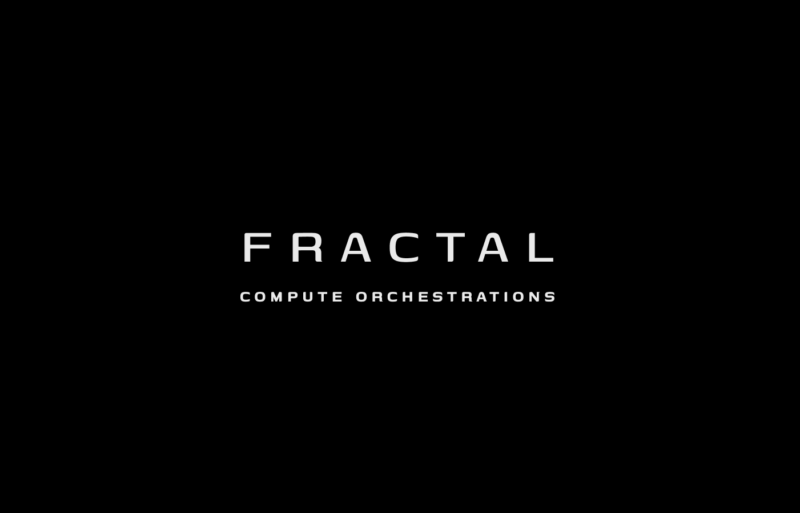

<div align="center">



# F R A C T A L
**C O M P U T E &nbsp; O R C H E S T R A T I O N S**
<br><br>
**Decentralized Edge Compute Harvesting, Sub-Byte INT4 Federated Learning, and Split LLM Inference.**

[](https://github.com/Fractal-Compute-Orchestrations)
[](LICENSE)
[](https://colab.research.google.com/github/Fractal-Compute-Orchestrations/FractalCore/blob/main/examples/colab_quickstart.ipynb)
[](https://github.com/Fractal-Compute-Orchestrations/FractalCore/actions/workflows/ci.yml)
[](https://github.com/Fractal-Compute-Orchestrations/FractalAndroid/actions/workflows/android.yml)
[](https://www.behance.net/gallery/221459335/Fractal)

<br>

[FractalWorkspace](https://github.com/Fractal-Compute-Orchestrations/FractalWorkspace) | [FractalCore (v1.0.0)](https://github.com/Fractal-Compute-Orchestrations/FractalCore) | [FractalAndroid](https://github.com/Fractal-Compute-Orchestrations/FractalAndroid) | [Colab Quickstart](https://colab.research.google.com/github/Fractal-Compute-Orchestrations/FractalCore/blob/main/examples/colab_quickstart.ipynb)

---
</div>

## Executive Overview

**Fractal Compute Orchestrations** engineers a distributed edge intelligence stack designed to train and serve modern neural architectures across fragmented consumer mobile hardware while protecting battery longevity, SoC thermals, and user data sovereignty.

Across its coordinated runtime modules, FRACTAL addresses the memory and bandwidth bottlenecks of on-device AI:

1. **Outlier-Resilient Micro-Block INT4 Transport (`fractal_quant` / `FRQ4` & `FRQD`)**: Confines high-kurtosis attention and projection outliers to 64-element blocks with error-feedback residual tracking, cutting TinyLlama-1.1B wire payloads by **7.1x** (`4,196 MB -> 590 MB`) while preserving **0.9878** mean layer cosine similarity (where naive per-tensor INT4 collapses to `0.8296`).
2. **Hardened Federated Orchestration & Byzantine Aggregation (`fractal_server`)**: Enforces multi-tenant path sandboxing, constant-time bearer/token auth, FedAvg (`weights` / `.frqd`), Coordinate Median, Krum Byzantine filtering, and FedProx proximal stabilization.
3. **Thermal-Gated Android Edge Runtime (`FractalAndroid`)**: Executes on-device TFLite training and wire-compatible `Int4BlockCodec` (`FRQ4`/`FRQD`) egress strictly when SoC thermals (`<= 40.0 C` and non-severe thermal status), battery state-of-charge, charging policy, and Wi-Fi constraints pass.
4. **Memory-Bounded Pipeline Parallel Slicing (`inference-model-maker`)**: Isolates decoder partitions under a `150 MB` edge RAM envelope and compresses inter-node activations into INT8 frames bounded to `4,100` bytes.

---

## Core Ecosystem Repositories

| Repository | Role | Key Capabilities & Stack |
| :--- | :--- | :--- |
| **[`FractalWorkspace`](https://github.com/Fractal-Compute-Orchestrations/FractalWorkspace)** | **Umbrella Architecture & Benchmarks** | Unified multi-repo submodule workspace, reproducible TinyLlama/MobileNetV3 Pareto frontier evaluation charts, and system contracts. |
| **[`FractalCore`](https://github.com/Fractal-Compute-Orchestrations/FractalCore)** | **Python SDK, CLI & Coordinator (`v1.0.0`)** | Installable `fractal_quant` SDK + `fractal doctor`/`bench` CLI, `fractal_server` federated coordinator, and ExecuTorch model slicer (`pytest` + Ruff CI). |
| **[`FractalAndroid`](https://github.com/Fractal-Compute-Orchestrations/FractalAndroid)** | **Android Edge Client Runtime** | Kotlin MVVM client, `Int4BlockCodec` bit-identical to Python `fractal_quant`, `OperationControl` thermal gating, and `FractalPaths` sandboxed storage. |

---

## Quickstart Verification (CPU)

```bash
git clone https://github.com/Fractal-Compute-Orchestrations/FractalCore.git
cd FractalCore
pip install -e ".[dev]"

fractal doctor
fractal bench --layers 4 --hidden-size 256
python scripts/quickstart_demo.py
pytest -v
```

---

## Empirical System Contracts

| Contract | Subsystem | Quantitative Guarantee |
| :--- | :--- | :--- |
| **Micro-Block INT4 Wire Reduction** | `fractal_quant` (`FRQ4` / `FRQD`) & Android `Int4BlockCodec` | **7.11x** wire reduction, `>= 0.9878` mean cosine fidelity across outliers |
| **Activation Frame Ceiling** | Inter-Node Activation Streaming | `<= 4,100 bytes` INT8 quantized activation frame |
| **Edge Partition Envelope** | `inference-model-maker` Slicer | `<= 150 MB` partition size for zero LMK memory eviction |
| **SoC & Battery Telemetry Gate** | Android `OperationControl` | Battery temp `<= 40.0 C`, non-severe thermal status, configurable SoC & Wi-Fi gates |
| **Tenant Storage Sandboxing** | `fractal_server` & `FractalPaths` | Canonical path containment + `X-Auth-Token` / `Authorization: Bearer` enforcement |

---

## Governance & Commercial Licensing

<div align="center">
  
</div>

<br>

FRACTAL and all companion repositories are maintained and owned by **[Fractal Compute Orchestrations](https://github.com/Fractal-Compute-Orchestrations)**.

- **License**: Proprietary Source-Available under the [FRACTAL Proprietary Source-Available & Non-Commercial Restrictive License v3.1](LICENSE).
- **Commercial Restriction**: Free for non-monetized academic research, personal study, and non-commercial evaluation. Commercial deployment, startup/company derivatives, hosted SaaS/PaaS APIs, and revenue generation are strictly prohibited without a separately executed written Commercial License from Fractal Compute Orchestrations.
- **Citation & Notice**: See [CITATION.cff](CITATION.cff) and [NOTICE](NOTICE).
- **Contact**: [Fractal Compute Orchestrations](https://github.com/Fractal-Compute-Orchestrations) (`ahmadhassan.bted@gmail.com`)
