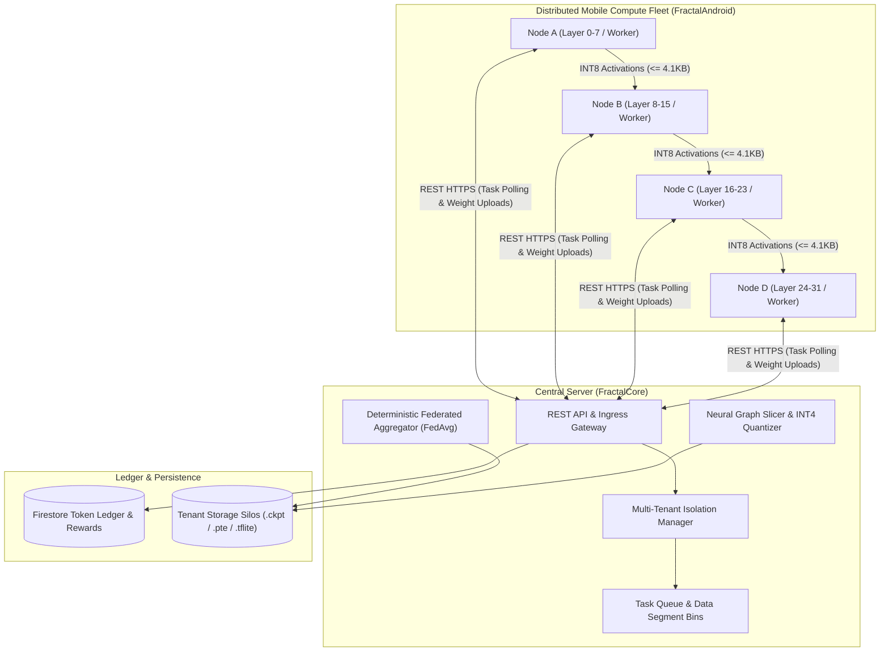

# F R A C T A L
**C O M P U T E &nbsp; O R C H E S T R A T I O N S**
  
**Pioneering the Future of Decentralized Intelligence.**

 

[FractalWorkspace](https://github.com/Fractal-Compute-Orchestrations/FractalWorkspace) | [FractalCore](https://github.com/Fractal-Compute-Orchestrations/FractalCore) | [FractalAndroid](https://github.com/Fractal-Compute-Orchestrations/FractalAndroid) | [Design Case Study](https://www.behance.net/gallery/221459335/Fractal)

---

## ⬡ Executive Overview

Fractal is an enterprise-grade distributed computing ecosystem engineered to harvest fragmented consumer compute across mobile edge devices while strictly preserving user privacy and device health. The framework treats edge devices not merely as remote processors, but as autonomous, resource-constrained nodes operating under human-centric constraints.

By bridging centralized control plane orchestration with on-device machine learning, Fractal resolves the memory and computation walls of modern deep learning across two foundational paradigms:

1. **Federated Learning (On-Device Training)**: Training neural network layers locally on edge hardware via TensorFlow Lite, eliminating raw data transfer to central servers, aggregating model updates with deterministic Federated Averaging (`FedAvg`), and tokenizing compute contributions through liquid data credits (**WiFi Bank**).
2. **Decentralized Pipeline Parallelism (Large Foundation Model Inference)**: Slicing monolithic foundation models (such as Llama 3 8B) into memory-bounded INT4 partitions ($\le$ 150MB `.pte` slices) mapped into device memory (`mmap`) without triggering mobile memory limits, streaming INT8 activation vectors across a distributed mobile mesh.

---

## ⬡ Core Ecosystem Repositories

| Subsystem | Designation | Technology Stack | Architectural Role |
| :--- | :--- | :--- | :--- |
| **[`FractalWorkspace`](https://github.com/Fractal-Compute-Orchestrations/FractalWorkspace)** | **The Nexus** | Git Submodules, System Specs | Master umbrella repository coordinating all submodules, architecture blueprints, unified documentation, and multi-repo development workflows. |
| **[`FractalCore`](https://github.com/Fractal-Compute-Orchestrations/FractalCore)** | **The Engine** | Python 3.10+, Flask, TFLite, PyTorch, Firestore | Central orchestration server, multi-tenant session isolation, data segment dispatching, FedAvg weight aggregator, and offline neural graph compiler. |
| **[`FractalAndroid`](https://github.com/Fractal-Compute-Orchestrations/FractalAndroid)** | **The Node** | Kotlin, Android SDK (API 24+), TFLite, MVVM | Native Android edge client application executing on-device training, real-time hardware telemetry gating (SoC temperature, battery SoC, memory pressure), and WiFi Bank rewards. |

---

## ⬡ System Architecture & Paradigms

---

## ⬡ Technical Specifications & System Contracts

| Contract Name | Target Subsystem | Engineering Specification |
| :--- | :--- | :--- |
| **Partition Weight Limit** | Slicer Compiler & Storage Tier | Binary slice $\le$ 150MB (`.pte` / `.tflite`) |
| **Activation Size Limit** | Inter-Node Transport Mesh | Tensor frame $\le$ 4,100 bytes (INT8) |
| **Hardware Telemetry Gate** | On-Device Execution (`OperationControl`) | Battery $\ge$ 50% or Charging == True, Battery Temp $\le$ 40.0 C |
| **Tenant Sandboxing** | Storage & Route Isolation | Physical silo: `data/tenants/{username}/` |
| **Stateless Auth Token** | Ingress Gateway | `X-Auth-Token` (`secrets.token_hex(32)`) |

---

## ⬡ Industry Validation & Accolades

- **Design Presentation**: View the official [Design Case Study on Behance](https://www.behance.net/gallery/221459335/Fractal).
- **Academic & Industry Recognition**: Formally recognized for technical excellence and innovative distributed architecture at the Air University FYP Open House 2026.

---

## ⬡ Join the Fractal Initiative

  

 

Fractal is actively expanding its core research and systems engineering initiatives. For architectural inquiries, academic collaborations, or engineering positions:

- **Lead Architect**: [Ahmad Hassan (B-Ted)](https://github.com/Fractal-Compute-Orchestrations)
- **Email**: `ahmadhassan.bted@gmail.com`
- **Organization**: [Fractal-Compute-Orchestrations](https://github.com/Fractal-Compute-Orchestrations)

 

  <b>F R A C T A L &nbsp; N E T W O R K</b> 
  <i>Decentralize Everything.</i>

