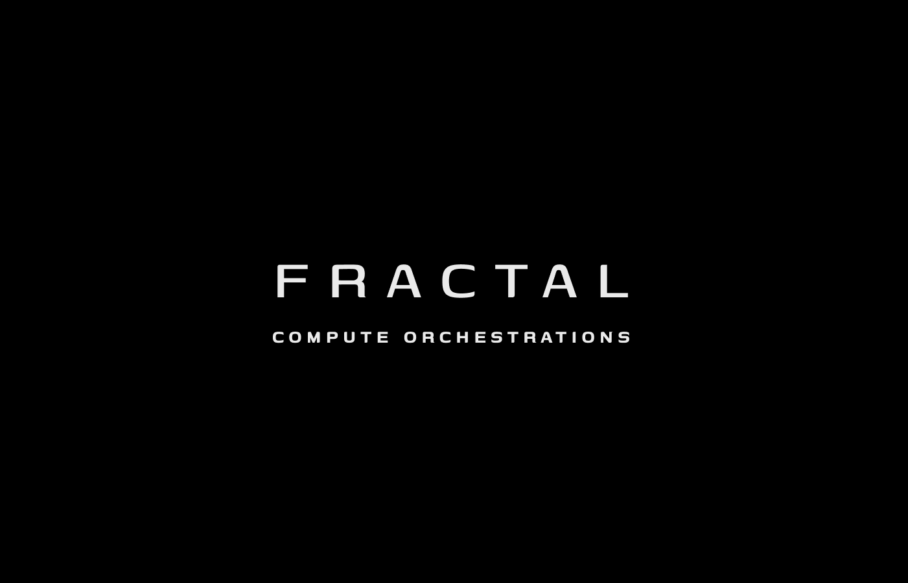

# F R A C T A L
**C O M P U T E &nbsp; O R C H E S T R A T I O N S**
  
**Decentralized Edge Compute Harvesting, Sub-Byte INT4 Federated Learning, and Split LLM Inference.**

 

[FractalWorkspace](https://github.com/Fractal-Compute-Orchestrations/FractalWorkspace) | [FractalCore](https://github.com/Fractal-Compute-Orchestrations/FractalCore) | [FractalAndroid](https://github.com/Fractal-Compute-Orchestrations/FractalAndroid)

---

## Ecosystem Overview

**Fractal Compute Orchestrations** builds privacy-preserving edge intelligence software across heterogeneous consumer mobile devices.

1. **Outlier-Resilient Micro-Block INT4 Compression (`fractal_quant`)**: 64-element block quantization (`FRQ4`/`FRQD`) with error-feedback residuals delivering **7.1x** wire reduction (`4,196 MB -> 590 MB` on TinyLlama-1.1B) at **0.9878** layer cosine similarity.
2. **Hardened Coordinator & Byzantine Aggregation (`fractal_server`)**: Canonical tenant storage isolation, constant-time bearer auth, and FedAvg/Median/Krum/FedProx aggregators.
3. **Thermal-Gated Android Compute Client (`FractalAndroid`)**: Kotlin wire-compatible `Int4BlockCodec`, `OperationControl` thermal gating (`<= 40.0 C` and `THERMAL_STATUS_SEVERE` checks), and `FractalPaths` storage isolation.

## Core Repositories

| Repository | Designation | Stack |
| :--- | :--- | :--- |
| **[`FractalWorkspace`](https://github.com/Fractal-Compute-Orchestrations/FractalWorkspace)** | Umbrella Specs & Benchmarks | Git Submodules, Pareto Frontier Evaluations, Contracts |
| **[`FractalCore`](https://github.com/Fractal-Compute-Orchestrations/FractalCore)** | Python SDK, CLI & Server (`v1.0.0`) | Python 3.10+, PyTorch, Flask, `fractal` CLI, `pytest` CI |
| **[`FractalAndroid`](https://github.com/Fractal-Compute-Orchestrations/FractalAndroid)** | Mobile Edge Runtime | Kotlin, Android SDK 24+, TFLite, Gradle Unit Tests |

  

FRACTAL is governed and owned by **Fractal Compute Orchestrations** under the FRACTAL Proprietary Source-Available & Non-Commercial Restrictive License v3.1 (see `LICENSE`).
